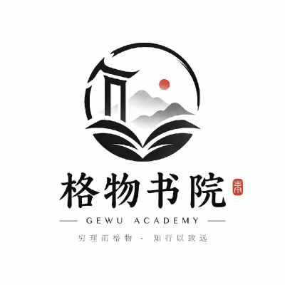

  

  # GeWu-academy (格物书院)

  
<em>穷理而格物 · 知行以致远</em>

面向开发者与设计师的实践社区。初衷：同行互帮互助，打磨硬核实战能力，消除求职与技术信息差，助力成员更好就业。

---

### 技术栈与实践方向

包含但不限于：

- **AI & Agent 开发**：LLM 应用、Multi-Agent 架构、工作流调度与工程落地
- **TypeScript 全栈**：TypeScript、React、Next.js、Node.js / 全栈生态
- **多语言全栈与系统工程**：Golang、Rust、Python 后端服务与高并发架构
- **UI/UX 设计**：产品交互设计、体验架构、原型输出与设计系统

---

### 协作与加入

欢迎提交 Issue 与 Pull Request。加入书院或共同协作，联系组织 Maintainer。
